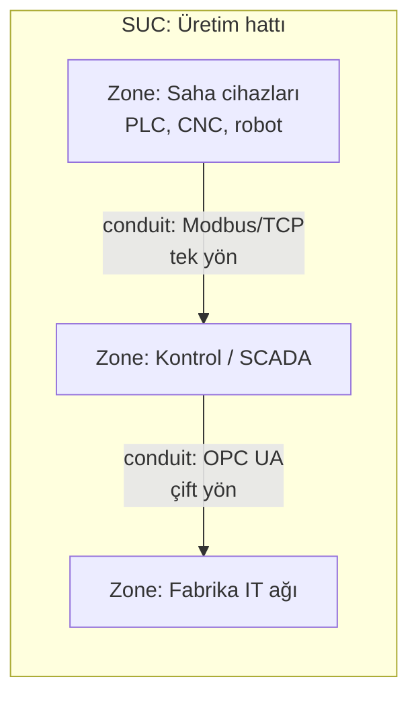
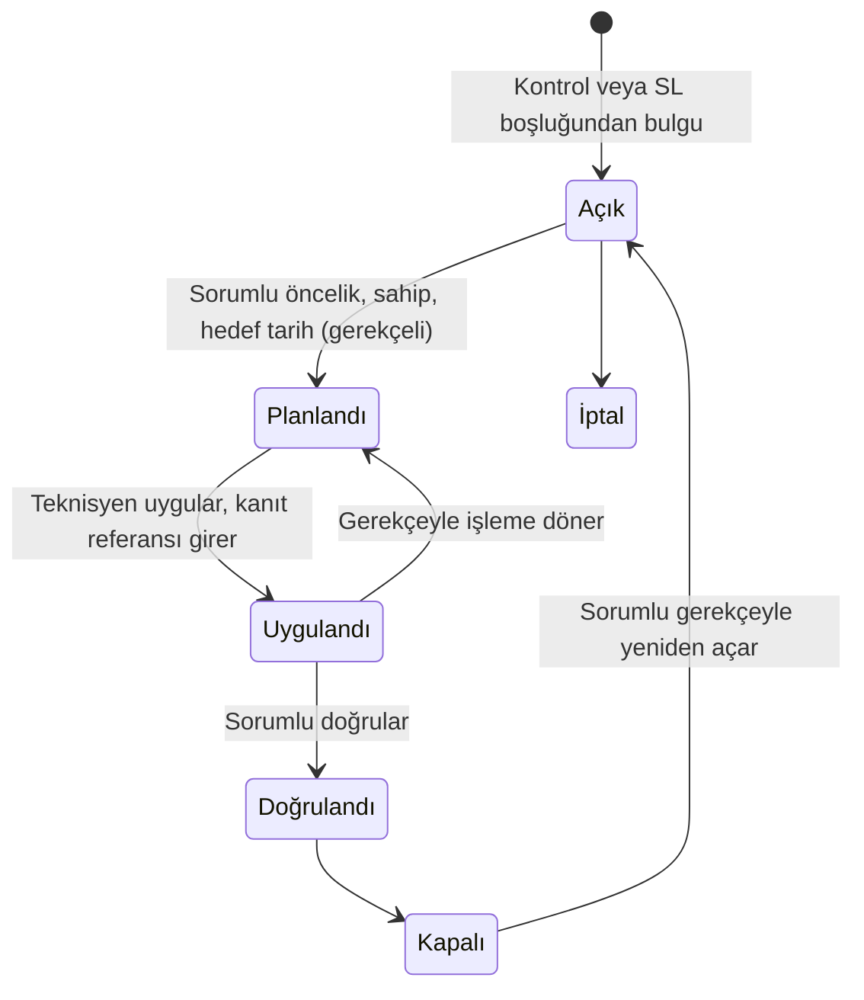
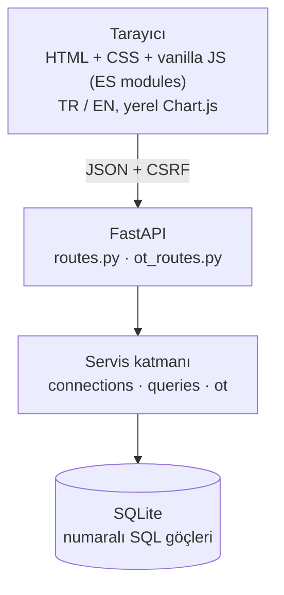

<p align="center">
  
</p>

<h3 align="center">Fabrika ağı için fiziksel bağlantı kaydı ve OT güvenlik yönetimi</h3>

<p align="center">
  
  
  
  
  
  
</p>

PortAtlas, bir fabrikadaki endüstriyel cihazların **hangi kabloyla, hangi switch portuna bağlı olduğunu** kayıt altında tutan; bağlantı değişikliklerini, arızaları ve **OT (Operasyonel Teknoloji) güvenlik durumunu** aynı veri modelinde birleştiren bir web uygulamasıdır.

Fikir basit: OT güvenliği, envanteri bilmeden yapılamaz. Hangi PLC'nin hangi portta olduğu, o bağlantıyı kimin ne zaman neden değiştirdiği ve cihazın hangi güvenlik bölgesinde durduğu ayrı Excel dosyalarında değil, tek bir doğrulanabilir kayıtta durur.

> **Durum:** v0.2.0, yerel demo. Gerçek sahada kullanıma hazır bir pilot değildir. Bir IEC 62443 uygunluk aracı da değildir (bkz. [Kapsam sınırları](#kapsam-sınırları)).

---

## İçindekiler

- [OT güvenlik modülü](#ot-güvenlik-modülü)
- [Fiziksel bağlantı ve arıza modülü](#fiziksel-bağlantı-ve-arıza-modülü)
- [Güvenlik tasarımı](#güvenlik-tasarımı)
- [Mimari](#mimari)
- [Kurulum](#kurulum)
- [Testler](#testler)
- [Dizin yapısı](#dizin-yapısı)
- [Kaynaklar](#kaynaklar)
- [Kapsam sınırları](#kapsam-sınırları)

---

## OT güvenlik modülü

Modül, **IEC 62443** serisindeki kavramları (SUC, zone, conduit, güvenlik seviyesi vektörü, FR1–FR7) kayıt ve iş akışı olarak modeller. Standart metni kopyalanmaz; kavramlar ürün kararlarına çevrilmiştir.

### Zone ve conduit modeli

| Kavram | PortAtlas'ta karşılığı |
| --- | --- |
| **SUC** (System under Consideration) | Değerlendirilen sistemin sınırı ve sorumlusu |
| **Zone** | Aynı güvenlik ihtiyacını paylaşan varlık grubu. Fiziksel konumdan **türetilmez**; bir cihazın tek bir birincil zone üyeliği vardır |
| **Conduit** | Aynı sistemdeki **iki farklı** zone arasındaki iletişim: yön (tek/çift), protokol ve port, amaç, koruma önlemleri |

Veritabanı bu kuralları kendisi zorlar: bileşik yabancı anahtarlar conduit uçlarının aynı sistemde kalmasını, `CHECK` kısıtı bir conduit'in kendine bağlanmamasını garanti eder.



### SL-A ve SL-T: iki ayrı kayıt

| | **SL-A** (Achieved) | **SL-T** (Target) |
| --- | --- | --- |
| Arayüzde | Mevcut değerlendirilen seviye | Hedef güvenlik seviyesi |
| Dayanak | Mevcut durum incelemesi ve kanıt referansı | Risk değerlendirmesi, karar veya gereksinim referansı |
| Kapsam | Zone veya conduit | Zone veya conduit |
| Değer | FR1–FR7 için **yedi ayrı** değer (0–4 veya *belirlenmedi*) | FR1–FR7 için yedi ayrı değer |
| Yetki | Yalnızca IT/OT sorumlusu | Yalnızca IT/OT sorumlusu |

Tasarım kararları:

- **Seviye otomatik atanmaz.** SL-A kontrol sayısından, SL-T cihaz kritikliğinden veya komşu zone'dan türetilmez.
- **Tek bir "genel SL" yoktur.** Ortalama, en düşük değer veya uygunluk yüzdesi üretilmez; vektör olduğu gibi tutulur.
- **`null` ile `0` farklıdır.** "Belirlenmedi" saklanır, sıfır sayılmaz. Bilinmeyen değer güvenli kabul edilmez.
- **Revizyonlu kayıt.** Değişiklik eskiyi güncellemez, yeni revizyon açar. Onay için yedi değer, gerekçe ve kanıt/risk referansı zorunludur.
- **Eskiyen profil işaretlenir.** Zone üyeliği, cihaz kritikliği veya ilgili bağlantı değişirse profil silinmez; **"Gözden geçirme gerekli"** olur ve karşılaştırmaya girmez.
- **Boşluk (gap) analizi.** İki güncel, onaylı profil arasında her FR için `max(0, SL-T − SL-A)` gösterilir. Bu yalnızca sıralı bir seviye farkıdır; risk puanı veya sertifikasyon sonucu değildir.

Boşluk olan FR'den, ilgili SL-T revizyonuna bağlı bir **bulgu** doğrudan açılabilir. Aynı hedef revizyon ve FR için açık bulgu varsa mükerrer kayıt oluşmaz, mevcut aksiyon önerilir.

### Cihaz kritikliği ve PortAtlas-OT-v1 kontrol listesi

Her cihaz için operasyonel kritiklik belirlenir (eksikse `bilinmiyor` kalır, güvenlik seviyesiyle karıştırılmaz) ve sürümlü, sabit sekiz maddelik liste uygulanır:

| Kod | Kontrol |
| --- | --- |
| OT01 | Cihazın operasyonel sorumlusu belirli mi? |
| OT02 | Makine, port ve kablo etiketleri kayıtla tutarlı mı? |
| OT03 | Kullanılmayan portların amacı ve uygunluğu gözden geçirildi mi? |
| OT04 | Uzaktan erişim durumu ve yetkili sorumlusu biliniyor mu? |
| OT05 | Güvenlik bölgesi ve operasyonel kritiklik gözden geçirildi mi? |
| OT06 | Son bağlantı değişikliğinin gerekçesi ve yapan kişisi kayıtlı mı? |
| OT07 | Ayar yedekleme ve geri dönüş sorumluluğu biliniyor mu? |
| OT08 | Cihaza ve ağ dolabına fiziksel erişim kontrolü gözden geçirildi mi? |

Sonuçlar dört ayrı durumdur: **Uygun**, **Uygun değil**, **Bilinmiyor**, **Uygulanamaz**.

- Tamamlanan kontrol **dondurulur**; yeniden kontrol yeni kayıt açar.
- *Uygulanamaz* kararı gerekçe ister ve ayrıca **sorumlu onayı** bekler.
- Bir cihazın portu taşınırsa ilgili maddeler (OT02, OT06) otomatik olarak "yeniden incelenmeli" işaretlenir; zone veya kritiklik değişirse OT05. Diğer sonuçlar korunur.

### Bulgu ve aksiyon yaşam döngüsü



Kurallar kod ve testlerle zorlanır:

- **Görev ayrılığı:** yüksek öncelikli bulguyu uygulayan kişi, aynı bulguyu doğrulayamaz.
- **Kanıt zorunlu:** kanıt referansı olmadan doğrulamaya gönderilemez.
- **Mükerrer ve yanlış kapsam engeli:** aynı kapsamda açık bulgu varken ikincisi açılmaz.
- **Geçmiş korunur:** sorumlu, tarih ve öncelik değişiklikleri OT geçmişinde izlenir; iptal kayıtları silinmez.
- Kapalı ve iptal bulgular "gecikmiş" sayılmaz.

### OT API

Tüm uçlar `/api/ot` altındadır ve `/docs` (OpenAPI) üzerinden denenebilir.

| Uç | İş |
| --- | --- |
| `GET /overview` | Zone/conduit profilleri, açık ve gecikmiş bulgular, bilinmeyen kritiklik, zone atanmamış cihazlar |
| `POST /systems` · `POST/PATCH /zones` · `PUT /zones/{id}/members` | SUC, zone ve üyelik |
| `POST/PATCH /conduits` | Conduit tanımı |
| `POST /levels` | SL-A / SL-T revizyonu (taslak veya onaylı) |
| `PUT /devices/{id}/criticality` · `GET /devices/{id}` | Cihaz güvenlik kaydı |
| `POST/PUT/GET /assessments` · `POST /assessments/{id}/approve-applicability` | Kontrol listesi ve uygulanamaz onayı |
| `POST /findings` · `PATCH /findings/{id}/plan` · `POST /findings/{id}/actions` | Bulgu, plan ve aksiyonlar |
| `GET /history` | OT denetim geçmişi |

Yeni tablolar `002_ot_security.sql` ve `003_finding_target_links.sql` göçleriyle eklenir. Mevcut cihaz ve bağlantı verileri sıfırlanmaz.

---

## Fiziksel bağlantı ve arıza modülü

OT kayıtlarının dayandığı envanter katmanı:

- Cihaz ekleme, düzenleme ve kullanım dışına alma; konum hiyerarşisi, kablo ve ağ arayüzü.
- **Bağlantı pasaportu:** çoklu arayüzlü cihazlar, 16/24 gibi değişken port sayılı switch'ler için görsel port paneli.
- **Gerekçeli bağlantı işlemleri:** kurma, port taşıma, kablo değişimi, sonlandırma. Her işlem tek bir transaction'dır ve önce/sonra geçmişi tutulur.
- **Ayrı saha doğrulaması:** bağlantıyı yapan ile doğrulayan ayrı kayıtlardır; uyuşmazlık da kaydedilir.
- **Arıza yaşam döngüsü:** açma, atama, müdahale, bekleme, doğrulanmış çözüm ve yeniden açma.
- Dashboard (yerel Chart.js), CSV raporu ve yazdırma görünümü.

Bütünlük kuralları SQLite katmanında zorlanır: bir kablo ucu aynı anda yalnızca tek aktif bağlantıya ait olabilir (kısmi unique index), eşzamanlı iki isteğin aynı hedef porta yazması durumunda biri başarılı, diğeri çakışma alır.

---

## Güvenlik tasarımı

Bir OT envanter uygulamasının kendisi de saldırı yüzeyidir. Uygulanan önlemler:

| Alan | Uygulama |
| --- | --- |
| **Parola saklama** | scrypt (`n=16384, r=8, p=1`) ve kullanıcı başına rastgele 16 baytlık tuz; düz metin parola saklanmaz |
| **Parola doğrulama** | `hmac.compare_digest` ile sabit süreli karşılaştırma; kullanıcı yoksa sahte hash ile aynı işlem yapılır (kullanıcı adı sızıntısı azaltılır) |
| **Oturum** | Rastgele belirteç; veritabanına yalnızca **SHA-256 özeti** yazılır. Çerez `HttpOnly` + `SameSite=Strict`, 8 saatlik ömür; giriş denemeleri sınırlanır. HTTPS arkasında `PORTATLAS_SECURE_COOKIE=true` |
| **CSRF** | Durum değiştiren isteklerde CSRF belirteci doğrulanır |
| **Yetki** | İki rol (IT/OT sorumlusu, saha teknisyeni). Yetki **backend'de** denetlenir; arayüzde düğmeyi gizlemek tek başına koruma sayılmaz. Pasif kullanıcı girişi reddedilir |
| **Tarayıcı başlıkları** | `Content-Security-Policy` (`default-src 'self'`, `script-src 'self'`, `frame-ancestors 'none'`), `X-Content-Type-Options: nosniff`, `Referrer-Policy: same-origin` |
| **Önbellek** | Tüm `/api/*` yanıtları `Cache-Control: no-store` |
| **Harici bağımlılık yok** | CDN kullanılmaz; Chart.js 4.6.1 lisansıyla birlikte yerel `vendor/` altındadır. CSP bu yüzden sıkı tutulabilir |
| **Hata yönetimi** | Tek biçimli JSON hata, her isteğe `X-Request-ID`. Veritabanı hataları ayrıntı sızdırmadan günlüğe yazılır |
| **Eşzamanlılık** | Kayıtlarda sürüm numarası (optimistic locking); eski sürümle yazma reddedilir. Tekrar eden istekler için idempotency anahtarı |
| **SQL** | Parametreli sorgular; dinamik parça yalnızca sabit tablo/sütun adlarından gelir |
| **Denetim izi** | Bağlantı, SL, kontrol ve bulgu değişiklikleri kimin/ne zaman/neden bilgisiyle saklanır, üzerine yazılmaz |

Demo hesapları yalnızca yerel, temsili veri içindir. **Gerçek ortamda varsayılan parolayı kullanmayın**; `python -m scripts.manage create-admin` ile kendi yöneticinizi oluşturun.

---

## Mimari



- **Backend:** Python, FastAPI, Pydantic v2, standart `sqlite3`. ORM yoktur; iş kuralları servis katmanında, bütünlük kısıtları SQL'dedir.
- **Frontend:** Derleme adımı ve framework yoktur. ES modülleri, hash tabanlı yönlendirme.
- **Veritabanı:** Tek dosya. Açılışta bekleyen göçler (`backend/db/migrations/001–003`) otomatik çalışır.
- **Dil:** Arayüz Türkçe ve İngilizcedir (TR/EN anahtarı). Kullanıcının girdiği cihaz/zone adları ve kanıt kayıtları çevrilmez.

---

## Kurulum

Python 3.11+ gerekir. Node veya frontend derlemesi gerekmez.

```bash
git clone https://github.com/eneskavakk/portAtlas.git
cd portAtlas

python3 -m venv .venv
source .venv/bin/activate
python -m pip install -r requirements-dev.txt

python -m scripts.manage demo        # temsili veriyle başla
python -m uvicorn backend.main:app --host 127.0.0.1 --port 8000
```

Uygulama: <http://127.0.0.1:8000> · API: <http://127.0.0.1:8000/docs>

Sonraki açılışlarda `./run.sh` yeterlidir.

| Hesap | Rol | Parola |
| --- | --- | --- |
| `admin` | IT/OT sorumlusu | `PortAtlas2026!` |
| `teknisyen` | Saha teknisyeni | `PortAtlas2026!` |

Bu hesaplar yalnızca `demo` komutuyla, boş veritabanında oluşur.

**Demo olmadan kurulum:**

```bash
python -m scripts.manage init
python -m scripts.manage create-admin
```

**OT örnek verisi** (temsili 1 SUC, 3 zone, 1 conduit; seviye veya kanıt uydurmaz):

```bash
python -m scripts.manage ot-demo
```

**Yapılandırma**

| Değişken | Varsayılan | Anlamı |
| --- | --- | --- |
| `PORTATLAS_DB` | `data/portatlas.db` | Veritabanı dosyası |
| `PORTATLAS_SECURE_COOKIE` | `false` | HTTPS arkasında `true` yapın |
| `PORTATLAS_PORT` | `8000` | `run.sh` portu |

**Yedek:** `python -m scripts.manage backup --output yedek.db` (hedef yeni dosya olmalı; mevcut dosyanın üzerine yazmaz, yedeğin bütünlüğünü kontrol eder).

### Önerilen ilk gezinti

1. `admin` ile girin ve menüden **OT güvenlik → Zone'lar**'a gidin.
2. Bir sistem kapsamı, ardından zone'lar ve aralarında bir conduit oluşturun; cihazları zone'lara atayın.
3. Bir zone için SL-T (hedef) ve SL-A (mevcut) revizyonu girip onaylayın; FR farkını görün ve farktan bulgu açın.
4. Aramada `CNC-014`'ü bulun, pasaportu açıp bir bağlantıyı başka porta taşıyın. Cihazın OT kontrol maddelerinin (OT02/OT06) nasıl "yeniden incelenmeli" olduğuna bakın.
5. `teknisyen` ile girip bulgu aksiyonunu kanıtla kaydedin; `admin` ile doğrulayın.

---

## Testler

```bash
python -m pytest -q                              # 45 test (çekirdek + OT)
node --test tests/frontend_i18n.test.mjs         # TR/EN çeviri tutarlılığı
```

Testler her seferinde yeni geçici SQLite veritabanı kullanır. OT testleri şunları doğrular:

- zone üyeliğinin konumdan bağımsızlığı ve tekilliği; farklı sistemler arası conduit engeli
- SL-A/SL-T bağımsızlığı, FR farkı, yedi değer ve dayanak zorunluluğu, `null` ile `0` ayrımı
- seviye revizyonları ve eski sürümle çakışma; üyelik veya port değişiminde profilin eskimesi
- eksik/bilinmeyen/uygulanamaz kontrol sonuçları; tamamlanmış kontrolün değiştirilememesi
- mükerrer ve yanlış kapsamlı bulgu engeli; kanıt zorunluluğu; **yüksek öncelikte farklı doğrulayıcı kuralı**
- eski veritabanının veri kaybı olmadan yükseltilmesi

Ek olarak gerçek API cevaplarından 12 OT görünümünün HTML üretimi ve role göre düğme görünürlüğü Node ile doğrulanır. Bu, tarayıcıda görsel/etkileşim kabulü yerine geçmez.

---

## Dizin yapısı

```
backend/
  api/            routes.py (çekirdek), ot_routes.py (OT)
  services/       connections.py, queries.py, ot.py (iş kuralları)
  db/             database.py, migrations/001–003 (SQL)
  schemas.py, ot_schemas.py, security.py, errors.py, main.py
frontend/
  index.html
  js/             app.js, ot.js, api.js, ui.js, i18n.js, translations.js
  css/            tokens.css, app.css, ot.css
  vendor/         Chart.js 4.6.1 (lisansıyla)
scripts/          manage.py (init, demo, ot-demo, create-admin, backup), seed_ot.py
tests/            test_core.py, test_ot.py, Node testleri
```

---

## Kaynaklar

Kavramsal kaynaklar: [IEC 62443-3-2](https://webstore.iec.ch/en/publication/30727), [ISA 62443-3-3 önizlemesi](https://www.isa.org/getmedia/d73509e9-b626-4709-a406-be6fc7616b79/ISA-62443-3-3_Preview.pdf), [Cisco IEC 62443 açıklaması](https://www.cisco.com/c/en/us/td/docs/solutions/Verticals/IoT_Security_Lab/IEC62443_WP.html).

---

## Kapsam sınırları

Bu proje dürüst olmayı hedefler; yapmadıkları:

- **Standart uygunluğu kararı vermez.** SL değerlerini insan girer ve onaylar. Uygulama sertifikasyon sonucu veya uyum yüzdesi üretmez.
- **Otomatik risk → SL üretimi yoktur.**
- **Canlı ağ taraması, firewall kuralı uygulama veya cihaz yapılandırması yoktur.** Conduit kaydı gerçek bir bağlantı veya uygulanmış kural iddiası değildir.
- SL-C (ürün kapasitesi) tutulmaz.
- Henüz yok: kontrollü toplu CSV aktarımı, dosya/fotoğraf kanıtı yükleme, kontrol şablonu düzenleme, gelişmiş kullanıcı yönetimi, parola yenileme, risk kayıtları ve kanıt matrisi.
- Yeni OT ekranlarının tarayıcı görsel kabulü ve gerçek saha pilotu yapılmamıştır.
